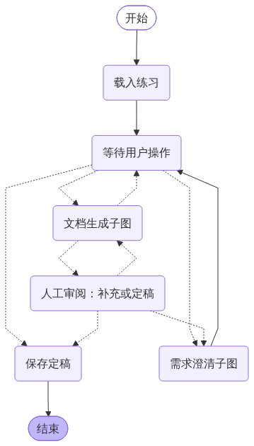

# Agent Lab · Agent Development Practice Studio

[简体中文](README.md) | **English**

Practice the stages of agent development through an interactive WebUI. Stage 1, **requirements clarification**, lets you choose a scenario, interview a stakeholder agent, take notes, and generate an evidence-linked requirements document. Stage 3, **technical design**, provides a workflow canvas, step list, and design review. Stage 5, **implementation**, is not implemented yet.

The application interface, practice scenarios, and workflow diagrams are currently in Chinese. This document is the English guide.

## Getting started

Requires Python 3.11+. Clone the repository and run these commands in PowerShell:

```powershell
git clone https://github.com/Ha11oWe1t/agent-learning.git
cd agent-learning
python -m venv .venv
.\.venv\Scripts\python.exe -m pip install -r requirements.txt
Copy-Item .env.example .env
.\start.ps1
```

Open http://127.0.0.1:4190. The startup script prefers the project's virtual environment, then falls back to `.venv` in the parent workspace directory. For subsequent launches, run `start.ps1` from the project directory.

## Model configuration

All live agents share the project's DeepSeek configuration: the displayed model name is **DeepSeek-V4.1-Flash**, the endpoint is `https://api.deepseek.com`, and the API model ID is `deepseek-flash`. The product display name is not used as the API request ID. See the [DeepSeek documentation](https://api-docs.deepseek.com/) for provider details.

Copy `.env.example` to `.env` in the project root and enter your key:

```dotenv
DEEPSEEK_API_KEY=your_api_key_here
```

The `DEEPSEEK_API_KEY` process environment variable takes precedence over the **project-local** `.env`. Configuration is read on every request; refresh the page after entering the key, without restarting the server. Keys from other projects are not loaded. `OPENAI_API_KEY`, `OPENAI_BASE_URL`, and `MODEL_NAME` are not used.

The key is excluded from LangGraph state, browser responses, and the session database. `.env` is ignored by Git; `.env.example` is a blank template.

- **Live mode:** a model plays the stakeholder and reveals relevant scenario facts in response to your questions. The summarizer receives only the public opening, actual conversation, and notes—not hidden scenario facts. Model calls send these materials to the provider and incur API charges.
- **Offline demo:** no network or model calls. Keyword matching selects fixed scenario facts. This mode demonstrates the interface and workflow; it does not provide open-ended conversation.
- Both modes use the same clarification workflow. You can start the app and use the demo without an API key; the interface reports missing configuration.
- Model requests time out after 120 seconds and are not automatically repeated. Failed requests preserve the question and retry ID instead of fabricating a reply. After refreshing, you can retry the same question. Chat requests use idempotency IDs, and unchanged input versions do not generate duplicate requirements documents.

## Requirements clarification (Stage 1)

1. Choose one of four generic scenarios: customer service, internal IT support, equipment troubleshooting, or sales follow-up.
2. Ask questions to clarify goals, scope, workflows, data, permissions, acceptance criteria, and constraints. Expand the guidance when needed.
3. Save notes in the right panel, or use **记笔记** beside a message to quote it. Notes support categories, editing, and deletion. Unsaved drafts stay in the browser; the note draft is saved automatically before document generation.
4. Generate a document after at least one conversation round. The summarizer separates confirmed requirements, open questions, and conflicts. Personal notes are not automatically treated as stakeholder commitments.
5. Click M/N source references to inspect the evidence snapshot used during generation. Review the result, then choose **确认定稿** (finalize) or **继续补充澄清** (continue clarification). Finalization is a practice action, not real stakeholder sign-off. Markdown exports include a complete evidence appendix. Further clarification marks older documents as stale; you can generate and browse new versions.
6. Restore sessions from the sidebar. Refreshing restores the current session. Data is stored in `data/practice.sqlite3`; stop the server before backing up this file.
7. Use **删除** beside a recent session to delete its conversation, notes, document versions, designs, and LangGraph checkpoints after confirmation. Corresponding browser drafts are also cleared. Deleting the active session returns to scenario selection; deleting another session does not interrupt the current one. Deletion cannot be undone, but exported files are unaffected.
8. Use **阶段指南** (stage guide) to view objectives, task lists, sample questions, deliverables, and completion criteria. The Stage 5 sidebar entry opens its guide only. Guides do not call a model, reveal hidden answers, or automatically judge completion, and remain available while a model reply is pending. On mobile, use the top-bar controls.

## Project structure

- `graph.py`: LangGraph `StateGraph`, state contracts, routing loops, human interrupts, durable recovery, and execution traces.
- `models.py`: shared DeepSeek client, using project-local configuration or the explicit DeepSeek environment variable.
- `schemas.py`: Pydantic models for requirements and summaries, shared exceptions, and categories.
- `scenarios.py`: public scenario descriptions and server-side hidden facts.
- `agents.py`: stakeholder and summarizer roles, independent source validation, and Markdown export.
- `app.py`: FastAPI endpoints, input validation, and per-session serialization.
- `storage.py`: SQLite session persistence, called by graph nodes to record conversations, notes, and documents.
- `design.py`: technical-design contracts and the LangGraph review workflow.
- `web/`: HTML, CSS, and JavaScript with no build step. Dynamic text is rendered using `textContent`.
- `tests/`: API, evidence validation, failure recovery, persistence, and design tests.

During requirements clarification, the stakeholder and summarizer collaborate in response to your actions. They do not chat autonomously with each other. You control when to ask questions and generate documents; summarization does not replace stakeholder confirmation. Source-ID validation ensures that cited evidence exists, but cannot prove that the model interpreted it correctly.

## LangGraph parent graph and subgraphs



The parent graph waits for input, dispatches two compiled subgraphs, and coordinates human review:

- **Clarification subgraph:** record the user's question, obtain the stakeholder reply, validate and record it, or save user notes.
- **Document subgraph:** load actual conversation and notes, summarize, validate sources, render Markdown, and persist a draft.

These are compiled `StateGraph` instances registered directly in the parent graph and inheriting its checkpointer, not just visual groupings.

[Clarification subgraph diagram](docs/clarification-native.png) · [Document subgraph diagram](docs/document-native.png)

## Workflow and persistence

### Practice scenarios

The included scenarios cover customer service, IT support, equipment troubleshooting, and sales follow-up. All characters, interfaces, scales, and acceptance figures are teaching examples, not descriptions of any company's actual operations. Hidden facts are not returned by the scenario-list API.

Conversation flow:

> Load session → wait for user → record question → stakeholder agent → validate and record reply → wait for user

Document flow:

> Read conversation and notes from the same graph state → summarizer → validate sources → render Markdown → save draft → human review

You can continue clarification or finalize the document after reviewing it. Recording and saving are deterministic graph nodes and do not require extra model calls.

`AsyncSqliteSaver` persists graph state in the same SQLite database. `await_user` and `human_review` pause with `interrupt()`; requests resume them using the same session ID and `Command(resume=...)`. Existing sessions join the graph on their next operation without losing previous conversations or documents. Older documents remain exportable.

See the [workflow and node guide (Chinese)](docs/workflow.md). To regenerate the diagrams with the project virtual environment:

```powershell
.\.venv\Scripts\python.exe render_graph.py
```

The diagrams use LangGraph's native `draw_mermaid_png()`. Only graph topology is sent to the Mermaid rendering service—not conversations, notes, or API keys. See [LangGraph interrupts](https://docs.langchain.com/oss/python/langgraph/interrupts).

The server listens on localhost by default and has no multi-user authentication; do not expose it directly to the internet. Run a single server process so per-session in-memory locks remain effective. Each practice session supports up to 50 conversation rounds and 60 notes. Background jobs, streaming responses, and status queries after browser disconnection are not supported. If a request is interrupted, refresh and check whether the result was saved before retrying.

## Validation

With the project virtual environment:

```powershell
.\.venv\Scripts\python.exe -m pytest -q
```

If you use the parent workspace's virtual environment instead, replace `.\.venv` with `..\.venv` in the test and diagram commands.

## Technical design practice (Stage 3)

Select **技术方案设计** in the sidebar to switch workspaces within the same page and keep the current practice session. You can also enter from a finalized requirements document. `/design` remains available as a standalone compatibility route. Select a finalized requirements version, then build your own workflow from the start and end nodes.

- **Canvas:** drag nodes to reposition them. Drag a connection handle to a target node, or click the handles in sequence, to create an edge. The step list stays synchronized. Click an existing edge to edit its natural-language condition or delete it.
- **Node configuration:** specify execution type, inputs, outputs, tools and knowledge sources, failure handling, agent assignment, and design rationale. Shift-click canvas nodes or select list checkboxes to assign an agent to multiple steps.
- **Saving:** browser drafts preserve unsaved edits; explicit saves write to SQLite. Revision checks prevent another page from silently overwriting your work. Download a JSON draft backup if a conflict occurs.
- **Review:** save your design, then ask the technical reviewer about the whole workflow or the selected node. Live mode uses the same DeepSeek configuration; offline mode explicitly checks only fields and graph connectivity. Review suggestions never edit your diagram automatically.
- **Decision log:** explain why you accept, defer, or reject each suggestion. The decision is added to your notes; you make any resulting design changes yourself. Markdown exports include nodes, edges, decisions, and revision-linked review history.

Designs are stored separately for each session and requirements version, bound to a fixed requirements snapshot. If clarification changes, the interface warns you rather than migrating the design automatically. Deleting a session also deletes its designs. This stage does not execute real business tools, simulate cases, or generate a complete design for you.

`design.py` defines the design contracts and LangGraph review flow: **structural checks → technical reviewer agent**. `web/design.*` implements the editor. Optional local scenario extensions remain under Git-ignored `data/`.
