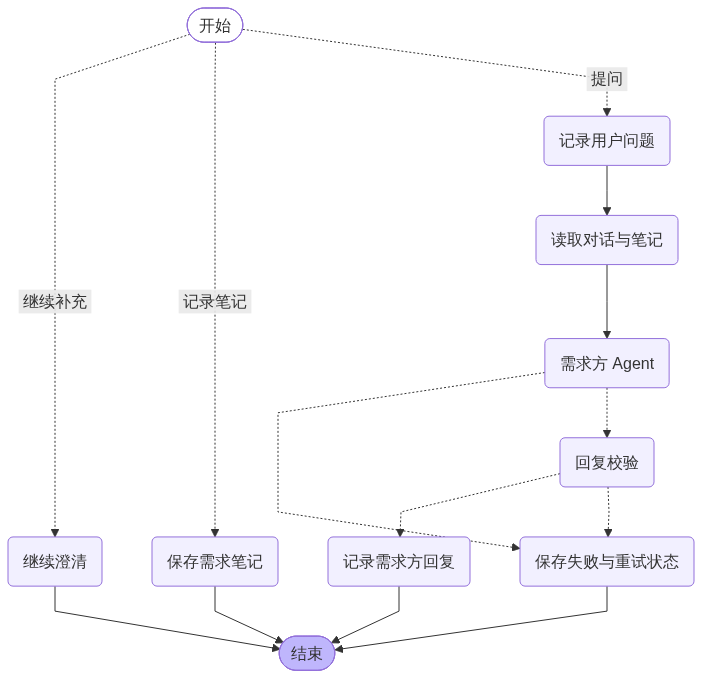
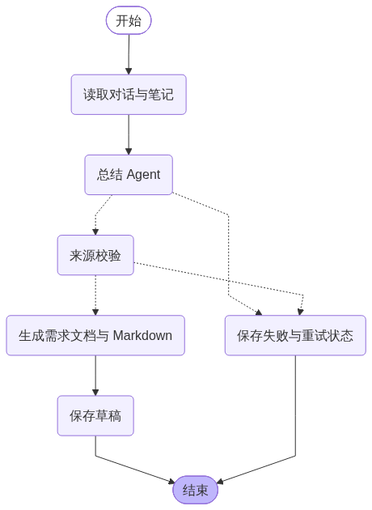
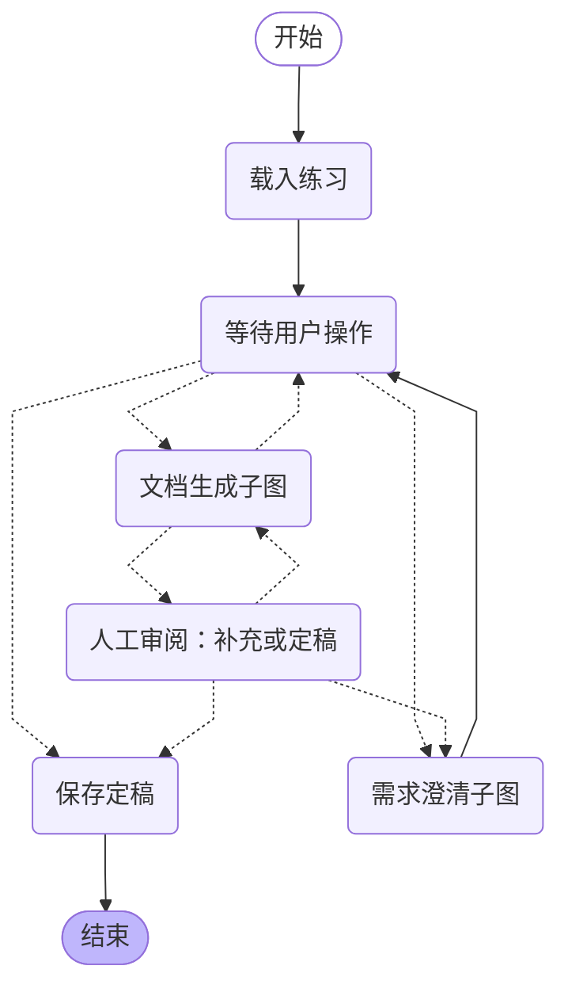

# 当前 LangGraph 工作流

## 需求澄清子图

## 文档生成子图

由实际编译图生成。等待输入和人工审阅使用 interrupt；每次请求用同一 session ID 恢复 SQLite checkpoint。

## 主图与子图节点

| 节点 | 职责 |
| --- | --- |
| `clarification` | 需求澄清子图 |
| `documentation` | 文档生成子图 |
| `initialize` | 载入练习 |
| `await_user` | 等待用户操作 |
| `record_user` | 记录用户问题 |
| `prepare_context` | 读取对话与笔记 |
| `stakeholder_agent` | 需求方 Agent |
| `validate_reply` | 回复校验 |
| `record_assistant` | 记录需求方回复 |
| `record_notes` | 保存需求笔记 |
| `summary_agent` | 总结 Agent |
| `validate_evidence` | 来源校验 |
| `assemble_document` | 生成需求文档与 Markdown |
| `save_draft` | 保存草稿 |
| `human_review` | 人工审阅：补充或定稿 |
| `save_final` | 保存定稿 |
| `continue_clarification` | 继续澄清 |
| `save_failure` | 保存失败与重试状态 |

## 状态字段

session, action, question, request_id, context, brief, answer, draft, summary, document, error, trace

需求方与总结是模型节点；记录、校验、文档渲染和保存是确定性节点，同属 Agent 工作流。
总结只读取实际对话、个人笔记及公开开场，不读取需求方隐藏设定。文档保存证据快照和 Markdown。
模型失败走 save_failure，保留已记录的问题；相同请求重试不重复追加问题。
定稿后图结束；继续补充会从已有会话开启下一次流程，旧文档与来源快照保留。
会话锁适用于单进程部署。图节点负责会话写入，checkpointer 负责节点恢复；密钥不进入两者。
